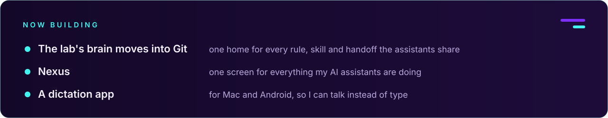

  

### Welcome in

*Vermaak* is Afrikaans for entertainment, so think of this as a lab where building things is the fun part.

This is my home base for the systems I build with AI: tools that plan the day, keep tasks in sync, turn meetings into notes, and let different AI assistants share the same memory and pick up where the other left off.

### What lives here

- **Assistants that work as a team.** Claude and ChatGPT reading from and writing to the same brain, so nothing gets lost between them.
- **Automation for everyday work.** Morning task sweeps, meeting transcripts, reports that build themselves.
- **Connectors.** Small bridges that let AI safely use the tools people already work in.
- **Skills.** Reusable playbooks that teach an assistant how a job should be done, once, so it is done right every time.

### How I build

1. Start with the real problem, not the shiny tool.
2. If it can't be done, look for the workaround. There usually is one.
3. Keep humans in charge of anything that matters.
4. Write it down, so the next person (or AI) can pick it up.

### Toolbelt

### Off the clock

Car culture and racing games: Forza, Need for Speed, The Crew, and counting down to GTA 6.

  

